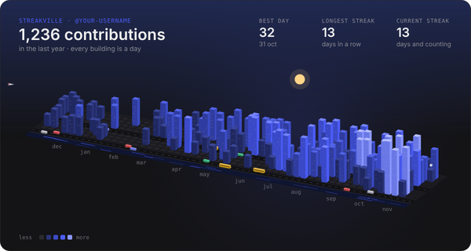
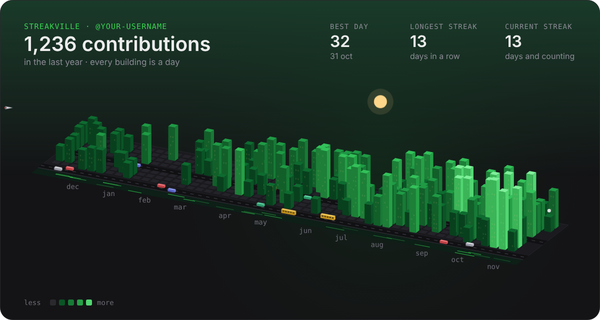
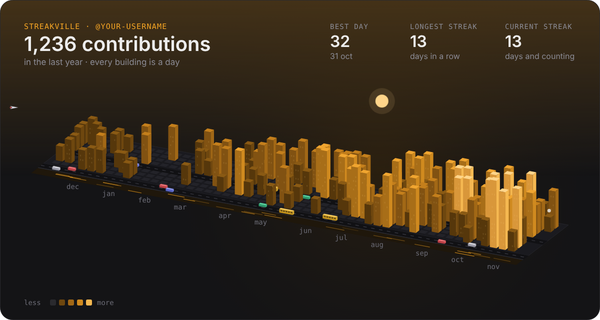
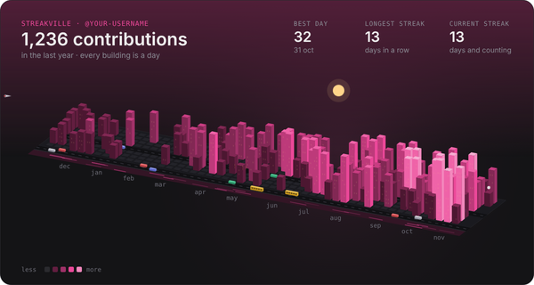
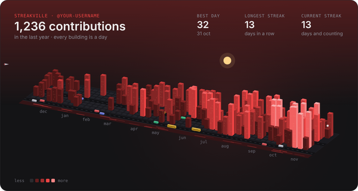
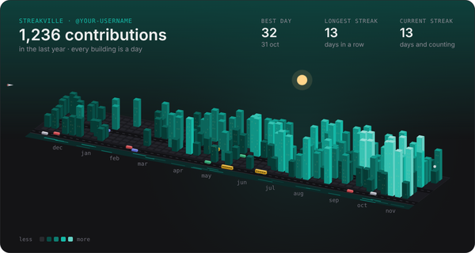
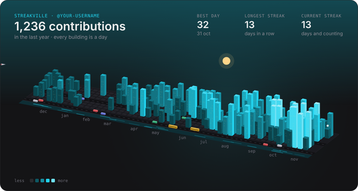
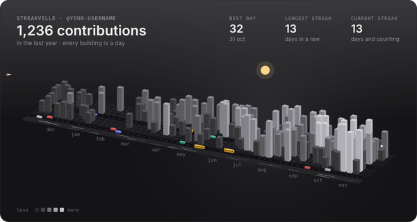

<div align="center">

# 🏙️ Streakville

**Turn your GitHub contributions into an animated city for your profile README.**

Every day of your year becomes a building. The more you commit, the taller it gets.
Cars drive down the avenues, the sun sets, the windows light up at night.



<sub>See it live on <a href="https://github.com/Brunito06">@Brunito06's profile</a>.</sub>

</div>

---

## ✨ Features

- 🏢 One building per day, height based on your contributions
- 🌗 Full day and night cycle, with lit windows, stars and the moon
- 🚗 Traffic on the avenues, a plane in the sky, waves on the river
- 📊 Total, best day, longest streak and current streak
- 🎨 9 colour themes, or any colour you want
- 🌍 Labels in English or Spanish
- ♿ Respects `prefers-reduced-motion`
- 🪶 Zero dependencies, just one SVG file

## 🚀 Set it up in 2 minutes

**1.** In your profile repo (the one called the same as your username), create the file `.github/workflows/streakville.yml`:

```yaml
name: Streakville

on:
  schedule:
    - cron: "0 6 * * *" # once a day
  workflow_dispatch:

permissions:
  contents: write

jobs:
  build:
    runs-on: ubuntu-latest
    steps:
      - uses: Brunito06/streakville@v1
        with:
          github_user_name: ${{ github.repository_owner }}
          output: dist/streakville.svg

      - uses: crazy-max/ghaction-github-pages@v4
        with:
          target_branch: output
          build_dir: dist
        env:
          GITHUB_TOKEN: ${{ secrets.GITHUB_TOKEN }}
```

**2.** Go to the **Actions** tab, pick **Streakville** and click **Run workflow**.

**3.** Add this to your `README.md` (change `YOUR_USERNAME`):

```md

```

That's it. Your city updates by itself every day. 🎉

## 🎨 Options

| Input | Default | Description |
| --- | --- | --- |
| `github_user_name` | repo owner | Whose contributions to draw |
| `output` | `dist/streakville.svg` | Where to save the SVG |
| `theme` | `indigo` | One of the themes below |
| `color` | — | Any hex colour, like `#ff6600` (overrides `theme`) |
| `lang` | `en` | `en` or `es` |
| `github_token` | `github.token` | Token used to read the contributions |

### Themes

| `indigo` | `green` | `amber` |
| --- | --- | --- |
|  |  |  |
| **`purple`** | **`pink`** | **`red`** |
|  |  |  |
| **`teal`** | **`cyan`** | **`mono`** |
|  |  |  |

### Your own colour

Don't like any of them? Pass any hex colour and the city builds all the shades from it:

```yaml
      - uses: Brunito06/streakville@v1
        with:
          color: "#ff6600"
```

## 💻 Run it locally

You only need Node.js 18 or newer.

```bash
# with sample data
node src/city.mjs --out city.svg

# with your real data
gh api graphql -f login=YOUR_USERNAME -f query='query($login:String!){ user(login:$login){ contributionsCollection { contributionCalendar { weeks { contributionDays { date contributionCount weekday } } } } } }' > data.json
node src/city.mjs --out city.svg --data data.json --user YOUR_USERNAME --color '#ff6600' --lang es
```

## 🤝 Contributing

Ideas, new themes and bug reports are welcome. Open an issue or a pull request.

If you like it, a ⭐ helps a lot!

## 📄 Licence

[MIT](LICENSE) © Bruno Jorba
